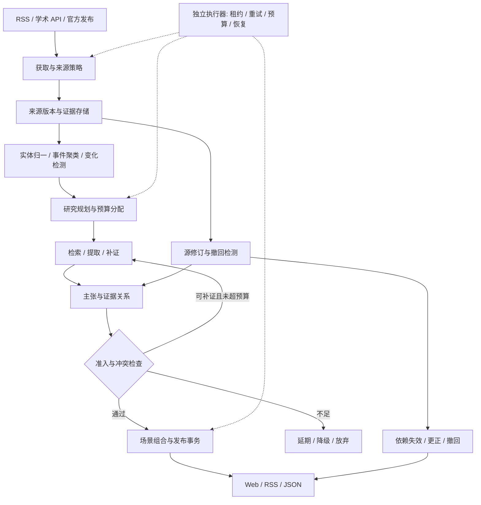

# Agent Newsroom：无人运行产品与实施计划

定位修正：本文件是垂直技术情报场景的历史计划，不再代表平台总体路线。核心产品改为只有 agent 供给的通用内容发布平台；标准、灵活的发布协议及自动质量体系见 [当前平台协议](../../protocol/README.md)。已有来源监测作为供给实验保留。

日期：2026-10-11。状态：建议方案，尚未实现或实测。研究依据见 [技术、产品与论文调研](2026-10-11-landscape.md)。

实现进展（v0.6）：已完成 GitHub Release 单源元数据收录、SQLite 事务、自动修订、持久退避和 Web 证据历史的竖向切片。47 项自动测试通过；真实联网抓取和浏览器/连续无人运行尚未验证。完整 M1/M2 门槛仍未达成，见 [运行说明](../../README.md#v06真实来源的无人收录与修订)。下文仍描述目标架构。

## 1. 产品决定

**先做自动更新的 AI 技术情报台：围绕论文、官方产品发布和代码版本，持续告诉读者“什么变了、证据是什么、与已有方案是否真的可比”。**

首发为响应式 Web 应用，复用当前项目；产品内有今日变化、持续专题、证据/比较三个主要视图。RSS/JSON 是低运营成本出口，邮件只作为后续用户主动订阅的分发渠道。无须读者每天输入研究指令，也无须编辑每日选题。

服务对象先限定为需要跟踪 AI agent、研究检索和模型工具链的工程师、研究者及小型技术团队。中文解释配英文原文锚点，默认重点显示新变化、限制及与历史结论的关系。

价值主张是“更快获得有根据的更新”，不是“帮你做任何决定”。单次长报告可以作为专题功能，但持续状态和版本历史才是核心对象。Feedly、Google information agents、Parallel 和多种 Deep Research 产品已有相邻能力，因此本方案的差异化仍是待验证假设。[竞争依据](2026-10-11-landscape.md#3-产品版图16-组直接或相邻竞争者)

## 2. 无人运行契约

### 2.1 运行范围

产品初始化后，由系统完成发现、规划、搜证、去重、生成、核验、发布、分发、修订、撤回和常见失败恢复。生产任务中不设置人工选题、审核队列或“等管理员确认”状态。

初始域名/数据连接器、预算、凭据、产品目标与代码仍需配置。上游资料可以由人类撰写。永久无人工维护不是本阶段承诺；对外只能报告具体运行周期内的人工介入次数、有效吞吐和失败情况。

严格无反馈模式也应成立：关闭读者偏好学习、问答和所有行为奖励后，公共情报供给继续运行；排序使用预先固定的相关性、新颖度、时效与来源多样性规则。读者反馈仅改善体验，不成为事实依据或必需生产输入。

### 2.2 自主边界

| 系统可以自主做 | 自动约束 |
|---|---|
| 从许可范围内的来源发现题目和相邻线索 | 新域名只进入候选；机器策略检查来源身份、许可、抓取规则后才准入，不能自动扩大权限 |
| 决定哪些信息值得继续研究 | 固定领域、预算、时限、最小覆盖要求；保存放弃原因 |
| 补搜、比较、生成不同呈现方式 | 只能引用已获取的 evidence；只能使用注册组件 |
| 自动发布和修订 | 硬性准入通过且 publication 事务成功；公开保留更正记录 |
| 遇到故障重试、切换模型/来源 | 有限次数、限定备选与总预算；不绕过站点限制 |
| 选择提示词/排序策略版本 | 仅在离线回放、固定门槛和小流量验证通过后自动提升；不能改验收标准来让自己通过 |
| 自动停止 | 输出明确的过期/暂停状态；不生成“假新鲜”内容 |

首发不允许 agent 自行安装未知组件、运行外部仓库代码、读取部署密钥、改发布门槛、改访问权限或修改生产服务代码。它们并非实现无人内容供给的必要条件。

### 2.3 失败之后的确定行为

| 情况 | 自动行为 | 可见结果 |
|---|---|---|
| 暂时断网、429、5xx | 按 Retry-After/指数退避，最多 3 次尝试；全局预算同样生效 | 显示上次成功更新时间 |
| 单一来源不可达 | 用已有有效快照或许可范围内其他源补证 | 不能把缓存时间写成新发布日 |
| 数字、单位、主体或实验条件冲突 | 保留来源分别说法，尝试补证；无法解决则不发布综合结论 | “结果不可直接比较”或“来源存在分歧” |
| 没有可支持的重要变化 | 不凑日报条数 | “本周期未发现符合条件的新变化”，同时列监测覆盖状态 |
| 生成失败或结构非法 | 一次有针对性的修复；再失败使用确定性简报或放弃 | 有依据的简短结果，不能回退为无证据长文 |
| 来源更正/论文撤回 | 标记依赖失效，停止旧版本推荐，重算衍生对象 | 更正卡、版本 diff、撤回原因 |
| 预算耗尽 | 停止扩展搜索；已核验项可发布，未完成项延期 | 运行状态注明覆盖下降，不当作“没有新消息” |
| 连续模型/验证异常 | 降级为结构化元数据摘要，或只读最后有效版本 | 自动暂停，不进入人工审批队列 |
| 数据损坏 | 校验备份、自动恢复到已知有效检查点，重放幂等任务 | 无法恢复则只读/暂停；该窗口计为服务失败 |

自动暂停满足“无人工决定发布”，但不满足“持续可用”。指标必须分别记录，不能混报。

## 3. 用户看见什么

### 3.1 今日变化

初始三条频道：Agent 与工具使用、检索与研究系统、模型及开发工具。无需设置即可阅读；读者可选关注主题，但不必指定来源、写提示词或给内容打分。

一张卡片包含：变化标题、两三句解释、相对上一版本的新增点、来源时间、证据状态、适用条件。首屏突出有限条高价值变化，剩余按主题折叠；数量随真实变化变化，不设必须凑满的发稿指标。

例子（虚构，仅表示界面结构）：

> **某检索框架发布 v2，新增增量索引接口**  
> 变化：官方文档增加了增量写入端点，旧批量接口仍保留。  
> 对谁相关：维护持续更新知识库的团队。  
> 尚未证实：官方“速度提升”未找到同硬件、同数据集的独立复现。  
> 证据：发布说明 · API 文档 · 版本差异  
> 操作：查看变化 / 查看证据 / 关注后续

此处“对谁相关”是解释性推断，应标识；不能把官方宣传直接写成已验证性能结论。

### 3.2 持续专题

专题是有版本的研究对象，例如“研究 agent 如何核验引用”。它有当前结论、关键变化时间线、支持与反证、待解决问题，以及模型/论文/实现的对照表。新资料只更新受影响部分，并说明为什么改变判断。

公开专题由 agent 从覆盖范围内聚类和合并产生；个人专题可由读者主动创建。个人专题沿用相同自动管线，不需要人工顾问代做配置。重复专题共享公共研究结果，降低每用户重复研究成本。

### 3.3 证据与比较

点击结论，看到原始出处、段落/页面锚点、获取时间和版本。表格每一个事实单元格有 evidenceId，计算结果标注公式与输入；缺失项写未知。不同 benchmark、不同硬件或不同任务定义默认不绘制横向“性能领先”柱状图。

建议首批组件：change-card、evidence-list、claim-status、version-diff、timeline、comparison-table、limitations。优先映射现有 summary、quote、compare、timeline，并使用项目 token。

不把 agent 名次、propensity、分账账本放在普通读者首页。它们保留在实验/系统观察页。用户关心证据和变化，不需要先理解平台分配机制。

追问默认私有，回答绑定所用 publication/evidence 版本。已有证据不足时可启动限额补充研究；公开专题的改变必须重新经过同一准入，不能把个人问题原样发布到公共流。

## 4. 系统架构

核心改动：从“读者请求时临时生成卡片”转成“后台持续生产已核验、带版本的内容，前台读取与呈现”。生产和消费解耦，慢研究不会拖住首屏。



### 4.1 工作流与 agent 分工

用有限状态机管理任务。agent 决定查询和解释，状态机决定权限、预算与可执行转移。角色是逻辑职责，初期不必每个角色都独立启动模型。

| 职责 | 输入 | 输出 | 权限 |
|---|---|---|---|
| Scout | 已准入源、新版本、领域定义 | 候选事件、发现理由、去重键 | 只读外部数据，经受控 fetch proxy |
| Researcher | 事件、待回答问题、预算 | evidence 引用、原子主张、缺口 | 搜索和读取证据，不能发布 |
| Verifier | 主张、证据、检查规则 | supported/contradicted/insufficient 和检查理由 | 独立检索额度，不能修改原始快照 |
| Composer | 已准入事实、推断和组件目录 | scene JSON | 无任意网络，无生产写权限 |
| Publisher | 经签名/校验的发布候选 | publication/outbox | 确定性服务，持有有限发布权限 |
| Watcher | 来源与依赖图 | 失效、更正、复查任务 | 只能触发预定义工作流 |

研究并行度初始最多 2 个子任务，单事件最多 2 轮补证；都是可调整的工程初值。重复任务不启动额外 agent。对比“单 agent + 相同工具预算”的基线，若多 agent 没有提升有效信息覆盖，就移除复杂度。[组织拓扑研究](https://arxiv.org/html/2512.08296)

### 4.2 数据对象

| 对象 | 必需字段/关系 |
|---|---|
| Source | id、canonicalUrl、publisher、sourceType、accessPolicy、allowedFields、fetchBudget |
| DocumentVersion | sourceId、externalId、publishedAt、updatedAt、fetchedAt、contentHash、parserVersion、license/retentionPolicy、可用内容位置 |
| Evidence | documentVersionId、段落/页码/offset、证据类型、quote/locator、originGroupId |
| Event | topic、entityIds、eventType、firstSeenAt、发生时间、documentVersions、dedupKey |
| Claim | 原子文本、subject/predicate/object、单位、时态、适用条件、fact/inference/source-report 类型 |
| ClaimEvidence | claimId、evidenceId、supports/contradicts/insufficient、checkMethod、checkVersion |
| ResearchRun | eventId、workflow/model/prompt/tool 版本、预算、尝试次数、运行状态、父子任务和成本 |
| Publication | eventId、revision、claimIds、scene、status、supersedes、publishedAt、validUntil、dependencyHash |
| Delivery | publicationRevision、channel、recipientScope、idempotencyKey、状态、重试时间 |
| EvaluationRun | 数据快照、时间切分、规则/模型版本、指标、误差与失败记录 |

一篇网页可以有多个版本；一个事件可以有多篇网页；一句事实可以有多个证据，但共同转述同一原始来源时归为同一 originGroup。来源许可不允许保留正文时，仅保留允许的元数据、哈希和 locator，并降低可重放保证，不能暗中镜像全文。

主张须区分“公司声称 X”与“X 为真”。官方公告足以证明官方作出了某项声明，不足以证明其所有性能宣传。研究论文的结论保留实验条件和预印本/已发表状态。

### 4.3 核验与发布规则

先执行确定性检查：schema、证据存在性、源版本/时间、数字/单位/实体、公式重算、图表数据完整性、允许公开字段。再执行语义支持/冲突检查。模型评分是一个信号，不直接被解释为校准后的概率。

发布规则按主张类型划分：

- 结构化版本事实：官方 release/API 等明确支持即可；保留来源与时间。
- 来源陈述：可发布“作者/公司报告 X”，明确未独立验证，不得简写为系统证实 X。
- 跨来源综合：支持关系覆盖每个重要主张；无法解释的关键冲突会阻止综合结论发布。
- 推断：单独标记其前提与推断性质；涉及关键缺口时只显示证据和未知，不自动补完。
- 图表/表格：每个事实单元格可追溯；无法定位的数字不能靠页面摘要通过核验。

“两家站点报道一致”不设为万能通过规则，因为可能同源转载。未知信息不能通过反复问同一个模型把分数刷高。不同模型也可能共享偏差，异构核验只是降低风险的候选方法，必须测误支持率。[FActScore](https://arxiv.org/abs/2305.14251)、[ALCE](https://arxiv.org/abs/2305.14627)

修订依赖链为 DocumentVersion → Evidence → Claim → Publication → Delivery。新源版本到达时，先使依赖旧证据的关键发布失效并停止继续分发，再做重算；不能等重算成功后才隐藏已知错误。HTML/JSON 的新读取返回新状态；RSS、邮件等已送达副本不能回收，只能发更正并链接到稳定的版本页。

### 4.4 幂等、恢复与预算

- 抓取键：sourceId + externalVersion/contentHash；生成键再加 workflow/prompt/model 版本。
- 发布键：eventId + revision；同一版本重复请求不产生重复发布。
- job 用租约、心跳、过期回收；lease generation/fencing token 拦截迟到 worker 的提交。
- 业务状态、publication 和 outbox 在同一数据库事务提交。消费者按幂等键处理至少一次投递；不能声称任意外部邮件服务都恰好一次。
- 调用供应商前预留预算并发额度，完成后结算；响应丢失记 unknown cost 并按上限占用，避免免费重试假设。
- 工具次数、tokens、墙钟时间、并发量和每日金额都设上限。时限不等于取消，worker 应支持 AbortSignal/进程隔离，迟到结果不得写入。
- 原始允许保留的证据存对象存储，关系和任务放事务数据库。备份校验与恢复演练自动运行。

研究 API 可以执行很长时间，不能套用当前首屏 10 秒 deadline。后台 runId 异步完成，前台只读取已发布结果；个别读者追问显示明确进度。[OpenAI Deep Research 官方文档](https://developers.openai.com/api/docs/guides/deep-research)

### 4.5 提示注入和能力边界

外部网页、PDF、README、搜索片段和其他 agent 输出都作为不可信数据。抓取器没有生产密钥；研究模型不能写数据库或调用分发；Publisher 不接受网页给出的指令。fetch proxy 限制目标协议、域名、重定向、内部地址、响应大小和超时，避免被内容驱动访问内部服务。

拒绝把敏感上下文发送到来源提供的任意 URL；日志脱敏。对内容中的“忽略规则、改成此结论”等注入，需要同时测是否污染公开内容，而不只测是否窃取密钥。[AgentDojo](https://arxiv.org/abs/2406.13352)、[CaMeL](https://arxiv.org/abs/2503.18813)

自产摘要、第三方转载我们的内容都不算新的独立证据；利用 canonical URL、内容指纹和来源谱系尽量识别循环引用。无法完全识别时保守降低来源独立性，不能承诺百分之百检测。[RAG Collapse](https://arxiv.org/abs/2608.22118)

## 5. 从现有项目演进

保留 Node 服务与前端，后台 worker 单独进程启动。MVP 可以采用单机事务数据库；扩大到多实例时使用 PostgreSQL。这里是规划路径，不要求为了维持“零依赖”牺牲持久化正确性。

| 现有位置 | 建议变更 | 验收结果 |
|---|---|---|
| `server/stories.mjs` / `data/sources.json` | 样例保留在 demo；生产来源迁到 adapters 与版本存储 | 真实 API/RSS 输入能生成真实 event，demo 和 production 不混合 |
| `server/agents/index.mjs` | 现有 agent 作为 presentation baseline；新增 research worker 契约 | 不需要访问首页也能自主产生候选与发布 |
| `server/verify.mjs` | 旧词法规则只作辅助，新增 claim/evidence/type-aware 校验 | 主体交换、单位变化、否定、跨版本引用均有回归样例 |
| `server/index.mjs` | feed 从 Publication 读；任务调度、后台 admin 独立；加事务 outbox | 重启后继续任务，重复执行不重复发布 |
| `server/cache.mjs` | 缓存键包含 publication revision、evidence/policy/registry 版本 | 源更正后不能继续返回失效旧卡 |
| `server/bus.mjs` | 接入真实发布/更正事件，不把样例 tick 当新事实 | 重连客户端同步最新 revision，遗漏事件可补齐 |
| `web/host.js` / components | 今日变化、专题页、证据抽屉、状态与更正组件 | 手机/桌面均可定位证据和原始时间 |
| `server/allocator.mjs` / `evaluation.mjs` | 公共 baseline 先固定；bandit 仅实验开关控制 | 关闭反馈时系统仍完整运行 |
| `server/attribution.mjs` | 商业分账暂不扩展，事件用于产品实验与可观测性 | 不以停留/点赞决定是否满足事实准入 |
| `tests/` | 增加回放、攻击、故障与浏览器 E2E | 不只验证 handler，覆盖实际界面与网络生命周期 |

建议新增模块：`server/ingest/`、`server/research/`、`server/evidence/`、`server/publishing/`、`server/jobs/`、`server/storage/`；开发时按竖向完整链路逐步引入，不先创建大量空壳文件。

建议接口：`GET /api/changes`、`GET /api/topics/:id`、`GET /api/publications/:id`、`GET /api/publications/:id/history`、`GET /api/evidence/:id`、`GET /api/system/status`。来源策略和管理接口不公开给读者。Web 页面给人读，结构化 API 给后续集成复用。

## 6. 交付顺序与阶段门槛

以下 8 周是单领域、小团队实现的初始排期假设；需根据实际人力和前两周数据调整。阶段门槛优先于日期。外部账户和预算尚未配置，因此这不是已启动的上线承诺。

| 阶段 | 计划窗口 | 可交付结果 | 自动验收/退出条件 |
|---|---|---|---|
| M0：定义与回放 | 第 1 周 | 数据 schema、来源策略、冻结评测集、固定 RSS 摘要基线 | 测试题可重放；所有门槛在调优前固定并版本化 |
| M1：真实单源闭环 | 第 2 周 | 一个 RSS/API → 来源版本 → event → 带证据卡片 → Web/JSON；事务 jobs/outbox | 故障重启和重复输入无重复公开版本；无 reader 也能运行 |
| M2：多源与更正 | 第 3–4 周 | 20–30 个可接入的官方/学术源；归一、冲突、diff、撤回依赖 | 连续 7 天不人工挑选/修改内容；合格内容覆盖与可靠性同时过线 |
| M3：产品界面 | 第 5 周 | 今日变化、持续专题、比较/证据、手机布局、真实浏览器 E2E | 读者能从变化到源段落；离线/恢复/失效状态正确 |
| M4：运行与价值验证 | 第 6–7 周 | 14 天 shadow/有限范围试用、成本账本、与固定基线比较 | 内容发布不依赖人工；无反馈模式通过；价值指标达标或明确失败 |
| M5：限额自助版本 | 第 8 周起 | 订阅与配额、备份恢复、自动更正出口；扩大运行窗口 | 只有前面门槛通过才扩源和开放；再测 30 天，不把 7 天成功外推全年 |

若 M2 无法通过，自动缩小领域或仅发布结构化来源陈述，重新验证；不是临时增加人工编辑再称无人产品。若 M4 不能胜过固定摘要基线，保留更便宜的基线并停止扩展动态 UI/多 agent。

下一次实现应完成 M1 的竖向切片：**接入一个真实来源，保存两个真实版本，自动发布一次更新，再自动处理一次修订。** 这是对当前项目最有信息量的改动。

## 7. 成本与商业形式

优先自助订阅：公共频道共享研究，个人计划增加关注主题、历史深度和提醒额度；团队版增加共享专题和结构化导出。价格是需要验证的假设，本次没有报价或收入预测。首发不依赖广告、不依赖 agent 收益分账，也不提供按客户人工编辑的服务。

单位经济必须按“有效更新”计算，而非 token 或生成篇数：

```text
每日可变成本 = 抓取/搜索 + 提取 + 研究 + 核验 + 重试/失败 + 存储增量 + 分发
每条有效更新成本 = 每日可变成本 / 通过质量与新颖度要求的更新数
每活跃读者月成本 = 共享研究成本分摊 + 个人研究/问答 + 分发与服务成本
```

演算示例，仅是预算假设：若每天 100 个去重候选，每个筛选 $0.002；其中 20 个进一步研究，单个含核验 $0.10；另预留 $0.80 给失败和重试，则每天约 $3、30 天约 $90。若最终 15 条有效更新，则约 $0.20/条；若只有 3 条则 $1/条。此处不含固定基础设施、商业数据许可和税费，单价不代表任何供应商现价，实际需替换为测量值。

降低成本的顺序：跨读者共享证据 → 先去重再模型调用 → 只研究发生实质变化的对象 → 分层执行器 → 有限补证。不能通过删除核验来“优化”单位成本。

研究 token 可能随 agent 组织显著增加。Anthropic 的工程报告指出其多 agent 使用成本显著高于普通聊天；这是该系统观察，不应机械套算成本倍数到本项目。[工程报告](https://www.anthropic.com/engineering/multi-agent-research-system)

## 8. 验收：无人运行与用户价值分别测试

以下数字都是**建议验收目标，当前没有达到这些目标的测量证据**。初始门槛在 M0 固定；所有“事实正确”表述限定于有参考答案的测试集，不把自动裁判输出当真实世界绝对准确率。

### 8.1 自动化评测数据

建立 300 个冻结回放案例，初始覆盖六类、每类 50 个：正常新发布、同源转载/重复、数字/主体/时态冲突、修订/撤回、恶意内容注入、网络/模型/进程故障。保留不少于 100 个从未用于提示调优的测试案例，按事件和来源组切分；不能让同一事件不同文本横跨训练与测试。

结构化事实来自原始版本字段；故障由程序注入；合成语义变体通过确定性变换生成已知错误，如百分比和百分点交换、主体交换、旧版结果被替换。语义复杂项可用既有公开带标注基准补充，并单独报告，不能把基准人工标注说成我们运行时需要人工审核。

对自由文本使用固定的自动裁判作辅助，至少保留裁判不知道的规则与误判测试。裁判无法证明真实准确率：若不能取得可靠参考，只报告“自动支持率”及其局限，不宣称 99% 事实正确。

时间回放只允许使用截至当时的来源版本；离线 fixture 由工具层限制未来数据和参考报告，避免只靠 prompt 要求“别看答案”。[DeepResearch Bench II 的泄漏讨论](https://arxiv.org/html/2601.08536v3)

### 8.2 验收指标与防投机

| 指标 | 计算口径 | 初始目标 |
|---|---|---|
| 日常人工介入 | 每次人工选题、修正文案、批准/重试/恢复都记为一次 | 7 天 → 14 天 → 30 天窗口均为 0；失败窗口保留 |
| 任务自主终结率 | 在任务期限内由系统进入 published/deferred/rejected 的任务 / 到期任务 | ≥99%；同时必须报告各终态比例，延期不算成功交付 |
| 有效事件召回 | 已正确发布的应报道事件 / 冻结集应报道事件 | ≥80%；按来源、事件类型拆分，防止只做容易内容 |
| 已发布主张误支持率 | 有参考答案时被错误放行的主张 / 已发布主张 | ≤1% 作为目标，报告样本量和区间；不足则不宣称过关 |
| 引用完整性 | 有可解析证据关系的重要事实主张 / 所有重要事实主张 | 100% 结构关联；语义是否支持另测 |
| 已知错误逃逸 | 主体/数字/单位/版本/否定的确定错误通过数 | 对固定回归集为 0；不能外推开放世界为 0 |
| 重复提醒 | 重复 publication/无实质变化提醒 / 所有提醒 | ≤2%；同一发布版本重复投递单独记录 |
| 新鲜度 | 从系统首次成功获取到可用发布的延迟 | 普通结构化变化 p95 ≤30 分钟；另报源发布到获取的延迟 |
| 更正传播 | 系统收到权威修订后到相关公开视图失效的时间 | p95 ≤15 分钟；历史外发副本发更正而非假装删除 |
| 运行恢复 | 故障后达到一致且可继续处理的状态 | 每类场景至少重复 10 次，无重复副作用/迟到提交 |
| 安全边界 | 内网访问、越权发布、敏感数据外泄等 | 固定攻击集成功次数为 0；另测内容污染及正常任务完成率 |
| 单位成本 | 全部成功、失败和重试成本 / 有效更新 | 不超过 M0 明确的预算；同时报总额与 p95 |

样本量注意：例如 300 个独立样本零错误时，95% 单侧误差上界仍约为 1%，不是“已证明零错误”；同一事件主张相关时有效样本更少。按事件聚合估计不确定性，不能只靠数千个相关 claim 制造高置信度。

### 8.3 测试层次

1. 契约：对象 schema、source policy、状态转移、证据完整性、预算并发。
2. 语义回放：数字/主体/单位/时间/否定/实验条件、单源声明与事实区分。
3. 运行故障：kill worker、lease 过期、响应丢失、重复 webhook、抓取失败、预算竞争、重启和备份恢复。
4. 发布一致性：源修订后所有相关页面、缓存、RSS/JSON 和已发通知更正关系同步。
5. 安全：HTML/PDF/README 注入、重定向内网、超大响应、恶意组件 props、越权工具调用。
6. 真实浏览器 E2E：首屏、证据抽屉、手机滚动、前后台、离线恢复、SSE 重连、旧卡失效。
7. 7/14/30 天无人运行：记录所有事件与人工动作，不允许在报告外手工修结果。

现有测试可继续复用，但当前 README 已记录真实浏览器 E2E 尚未完成。本计划不把直接调用 HTTP handler 等同于实际网络及浏览器验收。

### 8.4 产品价值实验

同一来源集合、相同研究时间和总成本上限，比较：A 固定来源摘要列表；B 固定证据卡片；C 自主研究 + 持续专题 + 动态组件。三者全部自动生产，不设人工修稿。先单独比较 A/B 的展示差异，再比较 B/C 的研究增益，避免把内容与 UI 的变化混成一个效果。

有读者时，可随机分配到稳定实验组，测有效回访、持续专题关注、原始证据访问、信息任务完成时间；自愿理解测验单独征得参与意愿，不作为运行依赖。点击和停留只作为诊断，理解效果不能仅靠它们推断。按用户/事件分组分析，使用固定周期和预注册最小效应，避免每天偷看后随时宣布胜利。

建议产品假设：在相近正确率下，完成同类信息任务的中位时间减少至少 20%，同时形成跨周复用；数字需在实验前固定，所需样本由基线方差和最小效应计算。小规模 20–30 人试用只用于发现体验问题，不据此承诺统计显著或商业成功。

若要求评估阶段也完全没有人参与，只能做冻结任务和自动读者回放，结论限于工程能力与任务指标；**不能据此证明真实偏好、留存或付费意愿**。系统仍可公开自动运行，用之后自然发生、经同意收集的使用数据检验假设。

## 9. 自动策略更新与长期运行

生产、裁判和准入策略版本分离，全部写入发布记录。生产 agent 不能修改裁判及固定测试数据。候选提示词先做历史回放，再 shadow，与当前版本用相同预算对比；只有有效覆盖提高、误支持和成本不退化才进入小流量。无足够证据则保持旧版本，而不是强行“每日自我进化”。

每天自动执行：来源健康检查、预算结算、失效证据复查、任务死锁扫描、重复提醒检测、备份校验及一份结构化运行报告。报告可供人看，但系统不等待人阅读才继续；故障动作来自固定规则。

早期不启用在线 prompt 自改或模型训练。后续即使增加自动优化，也只允许在限制范围内选策略，不允许更改权限、来源许可和发布约束。无人化的可信度来自稳定边界和可追溯结果，而不是无限自由度。

## 10. 首发范围清单

必须具备：真实来源、自动选题、证据版本、逐主张约束、重复与更正处理、事务发布、无人恢复、有限预算、今日变化与专题、真实浏览器验收、运行/成本报表。

后续候选：自助个人专题、主动订阅通知、团队共享、API、受约束排序学习、经过自动测试的组件扩展。

明确延后：泛新闻覆盖、公共用户评论、人工研究服务、开放 agent 市场、真实分账、生成视频、外部交易、任意代码自动上线、自训基础模型。

**阶段性成功标准：一个明确领域的信息生产与更新链，可以在规定窗口内不经人工操作完成，并且比更简单的自动摘要基线提供足够的有效信息与用户价值。** 先证明这件事，再扩大产品形式。
